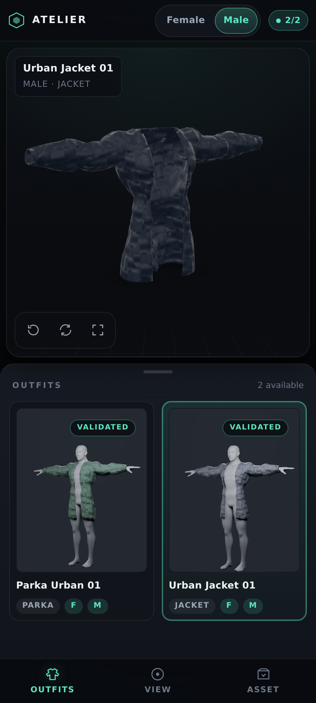
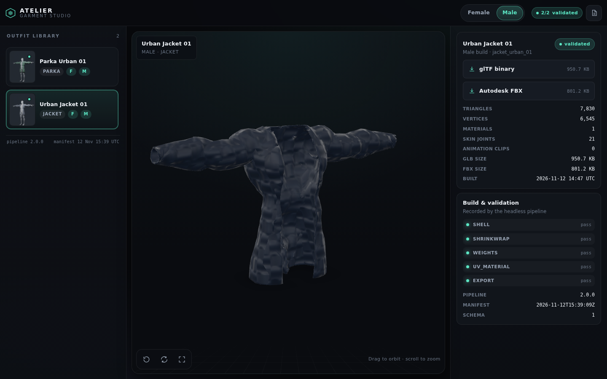
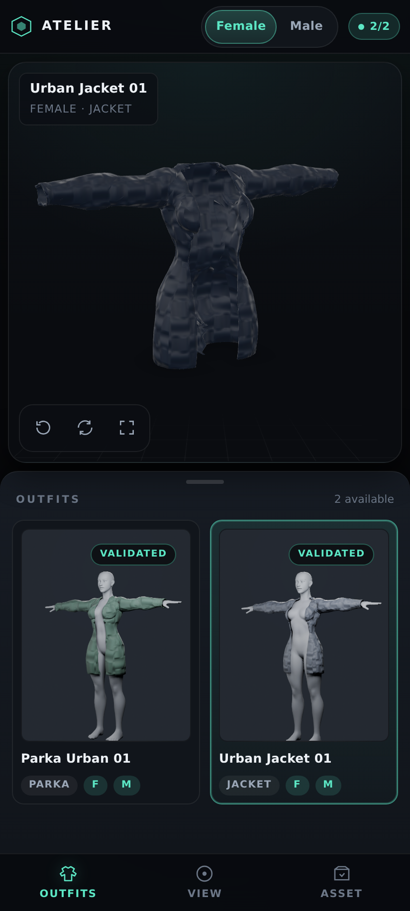
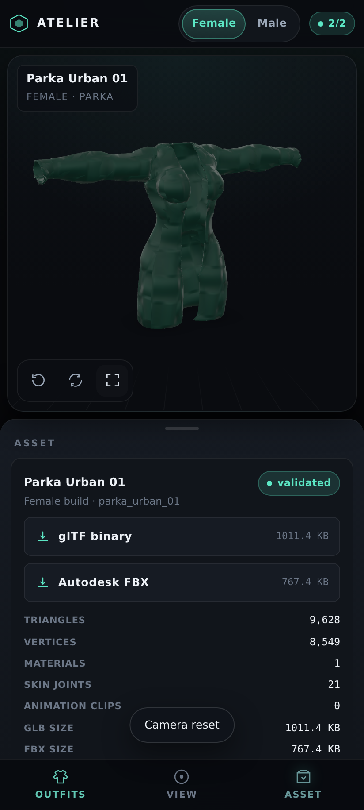
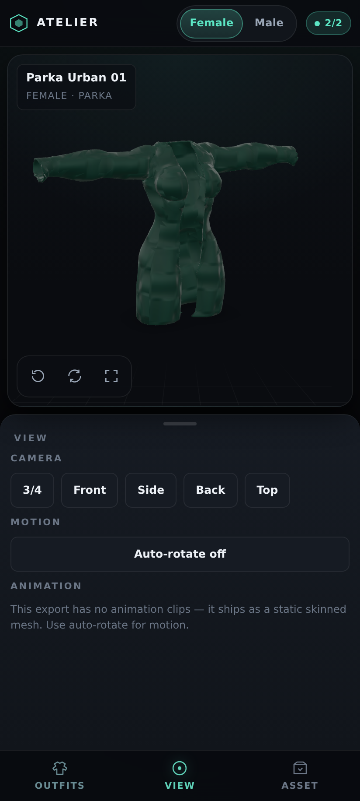
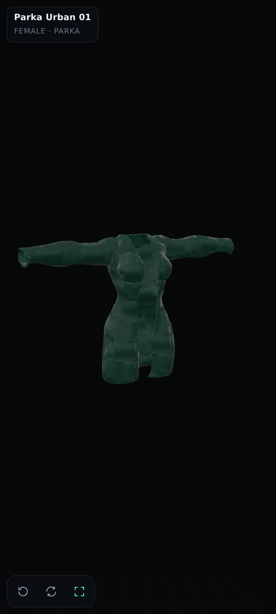
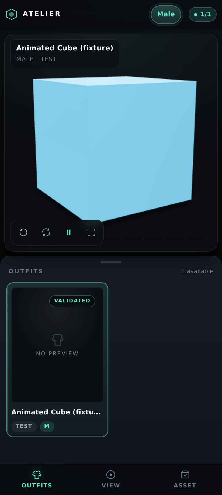
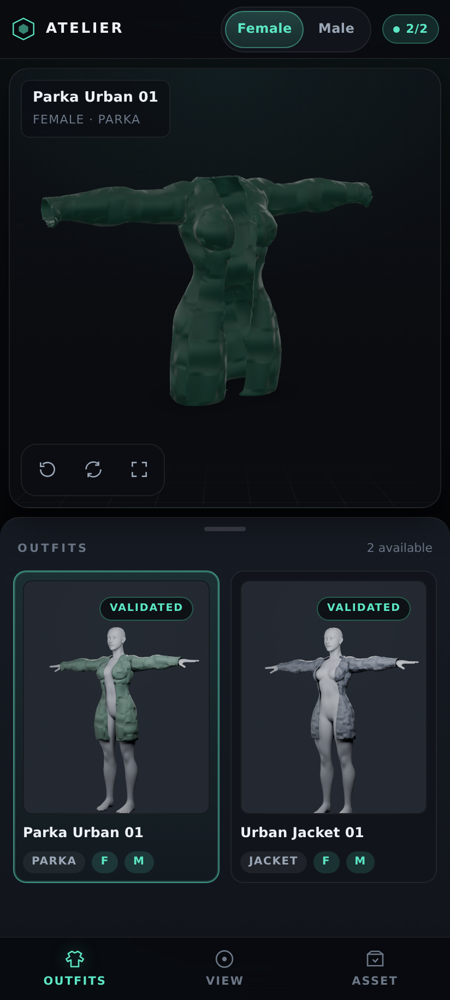
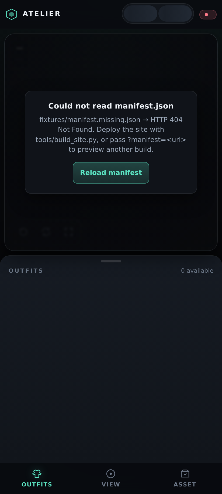

# Web studio testing report

How the studio (`web_viewer/` → `docs/`) is verified, what was actually run, and
what is still a known gap.

## Test layers

| Layer | Command | What it proves |
| --- | --- | --- |
| Python unit tests | `pytest tests/unit -q` | manifest generation, relative-path rules, asset discovery, `--check-only` validation (11 new tests in `tests/unit/test_build_site.py`) |
| Pipeline integration | `pytest tests -q` | the real Blender pipeline still passes for both variants after the asset/outfit additions (91 tests total) |
| Site assembly | `python tools/build_site.py --out docs --check-only` | every path in `manifest.json` exists, is relative and non-empty |
| Collector validation | `python tools/validate_exports.py --outfit <id> --variant <v> --khronos` | GLB/FBX structure + Khronos glTF Validator, per build, right after export |
| Published GLB validation | `node tools/gltf_validate.js --manifest docs/manifest.json` | re-validates **the exact GLBs the studio serves**, resolved through `manifest.json` (runs in CI before deploy) |
| **Real browser** | `node tools/browser_test.mjs --site docs` | Chromium drives the deployed layout: GLB loading, character/outfit switching, downloads, camera, fullscreen, animation transport, deep links, error states, subpath safety |

The browser suite runs against the assembled site served **under `/Blender/`**,
which reproduces GitHub project-page hosting — so a root-relative path that
would 404 in production fails the test instead of shipping.

## Result of the last run

Full table: [browser-test-report.md](browser-test-report.md) (regenerated on
every run and uploaded as a CI artifact).

```text
14 passed, 0 failed · report: docs/browser-test-results.json
```

Khronos glTF Validator over the published manifest:

| Outfit | Character | Errors | Warnings | Triangles | Skins | Influences |
| --- | --- | --- | --- | --- | --- | --- |
| `jacket_urban_01` | female | 0 | 0 | 8 301 | yes | 4 |
| `jacket_urban_01` | male | 0 | 0 | 7 830 | yes | 4 |
| `parka_urban_01` | female | 0 | 0 | 9 628 | yes | 4 |
| `parka_urban_01` | male | 0 | 0 | 8 732 | yes | 4 |

```text
{"summary":{"validated":4,"failed":0,"warnings":0}}
```

| # | Scenario | Notes |
| --- | --- | --- |
| 1 | mobile · shell renders from the manifest | 2 characters · 2 outfits · pill `2/2 validated` |
| 2 | mobile · GLB loads and renders | `outputs/male/jacket_urban_01/…glb` → 394 × 401 viewport |
| 3 | mobile · character switch without a reload | JS marker survives, `src` → `outputs/female/…` |
| 4 | mobile · outfit library switches builds | `jacket_urban_01` → `parka_urban_01` |
| 5 | mobile · view panel | 5 camera presets, "no animation clips" explained |
| 6 | mobile · camera reset, auto-rotate, fullscreen | native fullscreen, hero orbit restored |
| 7 | mobile · download links | relative hrefs, `download` attribute, HEAD 200, sizes 1011.4 KB / 767.4 KB |
| 8 | mobile · no failed requests or console errors | 30 requests, no 4xx/5xx, no page errors |
| 9 | mobile · animation transport | synthetic animated GLB: play/pause toggles state and `aria-pressed` |
| 10 | mobile · missing manifest | `?manifest=…missing.json` → HTTP 404 surfaced in the empty-state card |
| 11 | mobile · empty manifest | "No builds published yet", zero cards |
| 12 | desktop · layout | sidebar + stage + properties (300 / 768 / 372 px), tab bar hidden, 2 downloads |
| 13 | mobile · deep link | `?variant=female&outfit=parka_urban_01` selects card, character and asset |
| 14 | deployment · subpath safety | all 9 requests stay under `/Blender/`, no root-relative paths |

Timings are in the generated report; the whole suite takes ~30 s.

## Deployment verification

The suite above runs in CI against the **`studio-site` artifact** — the exact
bytes that `deploy` then uploads to Pages — so a green `webtest` is a green
deploy candidate, not a different build.

Run [43251111914](https://github.com/adii14990adi-spec/Blender/actions/runs/43251111914)
(PR #8) and, after merge, the `main` run of `Build & Deploy Studio`:

| Job | Result |
| --- | --- |
| `Detect changed areas` | pass |
| `Build <variant> · <outfit>` ×4 | pass (real Blender 5.0, exports validated, Khronos 0/0) |
| `Assemble studio` | pass (`site OK: docs`, every manifest path present) |
| `Browser tests` | pass (Khronos over the served manifest + 14/14 Chromium scenarios) |
| `Deploy studio to Pages` | pass — deployment `7742124813`, environment `https://adii14990adi-spec.github.io/Blender/` |

`deploy` re-checks `index.html`, `manifest.json`, the vendored viewer and every
GLB/FBX/preview path after stripping `.blend*`, so a partially assembled site
cannot be published. The only thing that cannot be exercised from this sandbox is
an actual `GET https://*.github.io/…` — outbound access to that host is blocked
here; the deployed artifact is the one the browser suite passed on.

## Screenshots

| Mobile (412 × 915) | Desktop (1440 × 900) |
| --- | --- |
|  |  |
|  | |
|  | |
|  | |
|  | |
|  | |
|  | |
|  | |

Files live in [`screenshots/`](screenshots/) and are regenerated by the browser
suite (and uploaded as the `studio-screenshots` CI artifact).

## Requirement checklist

| Requirement | Evidence |
| --- | --- |
| Opens on Android Chrome | Chromium (same engine) with a Pixel-class 412 × 915 viewport and Android UA; mobile layout assertions (tab bar visible, sidebar hidden) pass |
| GLB loads | Scenarios 2, 3, 4, 13 — `model-viewer` reports `loaded` and `modelIsVisible` |
| Male/female selection | Scenario 3, plus compatibility chips and per-character asset paths |
| Multiple outfits | Scenario 4 and 12 — `jacket_urban_01` **and** `parka_urban_01`, both characters |
| Rotate and zoom | `camera-controls` + touch handling; camera reset/orbit assertions in scenario 6 |
| Animation controls | Scenario 9 (fixture GLB with a clip); static exports hide the control by design |
| GLB + FBX downloads | Scenario 7 — real HEAD 200s, relative paths, sizes from the manifest |
| No 404s | Scenarios 8 and 14 — every request under `/Blender/`, none ≥ 400 |
| Pages deployment succeeds | `Build & Deploy Studio` workflow: `build` → `site` → `webtest` → `deploy`, with `deploy` gated on the tested bytes and restricted to `main` |

## Known gaps

- **Physical device**: the Android check is Chromium with mobile emulation, not a
  handset. Touch gesture *feel* (orbit inertia, pinch) is model-viewer's own, but
  it has not been eyeballed on real hardware here.
- **iOS Safari**: not exercised (no WebKit runner in the sandbox or in CI). The
  layout uses standard CSS (`dvh`, `env(safe-area-inset-*)`, Fullscreen API with
  a pseudo-fullscreen fallback) so it degrades, but it is untested.
- **Animation transport**: the pipeline exports static skinned garments
  (`animations: 0`), so the play/pause path is covered by a synthetic fixture
  rather than a real clip from the pipeline.
- **WebGL in the sandbox**: the test browser runs on SwiftShader (software GL);
  frame rate there is not representative of a GPU device.
- **No body in the viewport**: the exported GLBs contain the garment only, by
  design. Nothing renders *inside* the garment, so sleeve volume reads as
  floating cloth rather than a worn outfit. Adding a mannequin would mean
  shipping a second skinned mesh to every phone.
