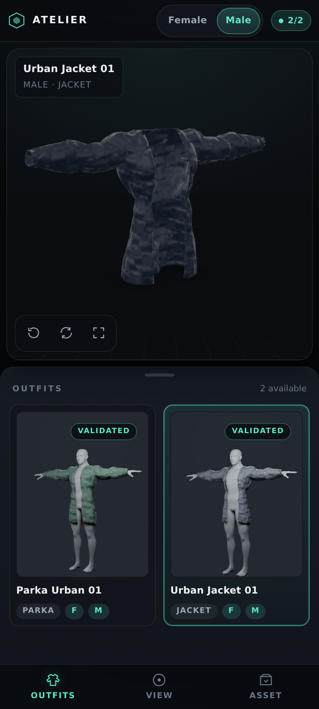

# Web studio (`web_viewer/` → `docs/`)

The repo ships a dark, mobile-first 3D review studio for the garments the
Blender pipeline produces. It is a static site — plain HTML, CSS and
JavaScript, no build step, no paid services, no runtime CDN — hosted on GitHub
Pages.



## What it does

| Area | Behaviour |
| --- | --- |
| Characters | Male / female switcher in the app bar; a switch swaps the loaded GLB in place, never reloads the page |
| Viewport | [`<model-viewer>`](https://modelviewer.dev) (vendored, BSD-3-Clause) with orbit/zoom/pan, touch and mouse, native fullscreen, camera presets, auto-rotate and a camera reset |
| Loading | Progress overlay driven by model-viewer's `progress` event, plus explicit error and empty states with a retry |
| Outfits | Discovered from `manifest.json`; every build that exists is listed with a rendered thumbnail, garment type, male/female compatibility chips and a validated badge |
| Assets | GLB and FBX downloads with real byte sizes, triangle/vertex counts, skin joints, animation count, build time and the per-stage validation verdict |
| Animation | Play/pause and a clip selector appear only when the GLB contains animation clips; static exports say so instead of showing a dead button |
| Layout | Phones: app bar · viewport · bottom sheet (Outfits / View / Asset tabs) · bottom navigation. Desktop: sidebar · viewport · properties panel |
| Deep links | `?variant=female&outfit=parka_urban_01` restores a selection; the last selection is also remembered in `localStorage` |

The GLB holds the **garment only** (no body mesh — see
[LIMITATIONS](LIMITATIONS.md)), so the viewport presents it as a free-standing
asset; the library thumbnails are rendered from the `.blend` and therefore show
it on the mannequin.

Only files that exist at build time are listed, so a download button can never
point at an asset that was not published. The app also HEAD-checks both files
after a character switch and disables the row with the HTTP status if the
deployment is stale.

## Files

```
web_viewer/
├── index.html                 # studio shell (app bar, stage, panels, tab bar)
├── css/styles.css             # design tokens + mobile-first layout
├── js/app.js                  # manifest-driven state machine, viewer events, panels
├── vendor/model-viewer.min.js # vendored @google/model-viewer 4.4.0 (no CDN at runtime)
└── favicon.svg
```

The deployed site is assembled by `tools/build_site.py` into `docs/`:

```
docs/
├── index.html · css/ · js/ · vendor/ · favicon.svg   # copied frontend
├── manifest.json                                     # generated catalogue
├── outputs/<variant>/<outfit>/                       # validated GLB/FBX + preview + report
├── screenshots/                                      # browser-test screenshots
└── *.md                                              # pipeline docs
```

## `manifest.json`

`tools/build_site.py` writes it from what is actually on disk — the frontend has
no knowledge of any specific outfit or path.

```jsonc
{
  "schema": 1,
  "generated_at": "2026-11-12T15:26:03Z",
  "pipeline_version": "2.0.0",
  "default_variant": "male",
  "characters": [{ "id": "male", "label": "Male", "height_m": 1.82 }, …],
  "outfits": [
    {
      "id": "jacket_urban_01",
      "name": "Urban Jacket 01",
      "kind": "jacket",
      "compatibility": ["female", "male"],
      "variants": {
        "male": {
          "glb":  { "path": "outputs/male/jacket_urban_01/jacket_urban_01_Modular.glb",
                    "bytes": 973548, "size": "950.7 KB" },
          "fbx":  { "path": "…/jacket_urban_01_Modular.fbx", "bytes": 820460, "size": "801.2 KB" },
          "preview": { "path": "…/preview.png" },
          "validation": { "status": "pass", "stages": [{ "stage": "shell", "status": "pass" }] },
          "stats": { "triangles": 7830, "vertices": 6545, "joints": 21, "animations": 0 },
          "built_at": "2026-11-12 14:47 UTC"
        }
      }
    }
  ]
}
```

Every path is **relative** — no leading `/`, no absolute URLs, no `..` — so the
same build works at `https://<user>.github.io/Blender/` and at a domain root.
`build_site.py --check-only` re-validates that rule and that every listed file
exists.

### Adding an outfit to the studio

1. Add the garment definition to `assets/outfits/outfits.json`.
2. Run the pipeline for it (`--outfit <id>`), which writes
   `outputs/<variant>/<outfit>/`.
3. `python tools/render_previews.py` renders the thumbnail.
4. `python tools/build_site.py --out docs` — the outfit appears in the library
   automatically. Nothing in `web_viewer/` changes.

## Local preview

```bash
python tools/serve_viewer.py            # build docs/ + serve http://localhost:8099
python tools/serve_viewer.py --no-build # serve an existing build
```

The helper assembles the site first, so the preview always matches the deployed
bytes (relative paths, MIME types, no-cache headers). Serve it from a real HTTP
server — `model-viewer` cannot fetch a GLB over `file://`.

## Deployment

`.github/workflows/blender-build.yml` publishes the studio:

1. **changes** — classifies the push. `web_viewer/**`, `docs/**`,
   `tests/fixtures/**` and workflow files are frontend-only: the Blender matrix
   is skipped and the last validated exports are restored from the Actions cache
   (key `assets-v1-*`).
2. **build** — matrix of `<male|female> × <jacket_urban_01|parka_urban_01>`:
   run the pipeline with real Blender 5.0, validate GLB/FBX (project inspectors +
   Khronos), render the thumbnail, upload the shippable files.
3. **site** — assembles `docs/` (`tools/build_site.py`), refreshes
   `BUILD_REPORT.md`, validates every manifest path, caches the export tree,
   uploads the Pages artifact.
4. **webtest** — installs Chrome tooling and drives the studio with
   `tools/browser_test.mjs` (see [WEB_TESTING.md](WEB_TESTING.md)).
5. **deploy** — re-validates the artifact, uploads it with
   `actions/upload-pages-artifact`, then `actions/deploy-pages`. PRs build and
   test exactly the same bytes but never deploy.

Pages must be configured once: **Settings → Pages → Source: GitHub Actions**.

## Browser support

Tested in Chromium (mobile emulation at 412 × 915 and desktop 1440 × 900; see the
test report) and with `bpy`-generated GLBs. The studio needs ES2020, WebGL2 and
`customElements` — Android Chrome 90+, Chrome/Edge 90+, Firefox 90+, Safari 16+
(all of which ship `model-viewer`'s required platform features). It degrades to
an explicit "3D engine unavailable" card if WebGL or the vendored bundle fails,
rather than a blank viewport.

## Troubleshooting

| Symptom | Cause | Fix |
| --- | --- | --- |
| "Could not read manifest.json" | site opened without a manifest (e.g. `file://`, or a partial deploy) | run `python tools/build_site.py --out docs`, or pass `?manifest=<url>` |
| Models list but the viewport stays empty | WebGL blocked (hardware acceleration off) | enable hardware acceleration, or check the browser console for the model-viewer error |
| Download row says "missing (HTTP 404)" | manifest is newer than the deployed assets | re-run the deploy; the row re-enables itself after a reload |
| A new outfit does not appear | manifest not regenerated | `python tools/build_site.py --out docs` then redeploy |
